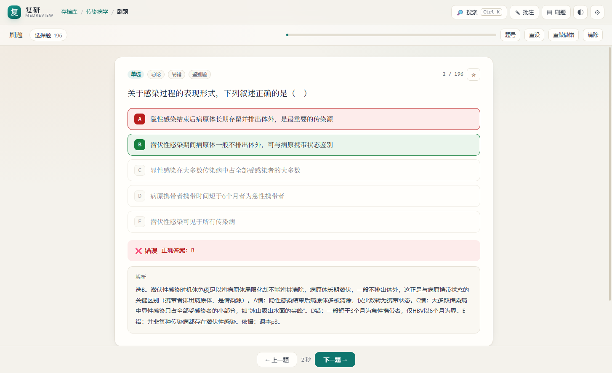

# 复研 MedReview · Windows 测试版 v0.1

> 一个「外壳 + 存档」式的复习软件：软件负责阅读、检索、刷题、批注、问 AI；**存档**承载一门课的内容与题库。
> 换课 = 换存档，不用改代码。

- 位置：`D:\学习资料\_复习站App\fuyan`
- 现成存档：**传染病学**（196 题）、**消化系统**（62 题）
- 来源：好友的 [shauti-app](https://github.com/Cheakerion/shauti-app)（Kotlin/Compose 刷题 App）+ 两份复习站的内容与视觉

---

## 一、怎么跑起来

**双击桌面图标「复研 MedReview」**（或开始菜单里的同名图标）。

- 桌面 / 开始菜单快捷方式已在安装时创建；图标是 `assets\icon.ico`。
- 快捷方式调用 `启动复研.vbs`：**不弹黑框**，直接起服务并打开应用窗口；
- 已经在运行时，再双击只会把已有窗口调到前面（单实例），不会开第二个服务；
- 想看日志/排错时，改用 `启动复研.bat`（带控制台）。

它会：
1. 启动本地服务（`127.0.0.1:5279`，端口被占会自动往后退）；
2. 用 Edge 的「应用窗口」打开界面（没有地址栏/标签页，像一个独立软件）；
3. 数据放在 `data\`；「设置 → 退出软件」可以关掉服务。

命令行也可以：

```powershell
node server.js                 # 打开界面
node server.js --no-open       # 只起服务，自己开浏览器
node server.js --port 5300     # 指定端口
```

> 不需要 npm install：整个程序零第三方依赖，只用 Node 自带模块。
> 需要 Node 18+（本机 `D:\node.exe` v24 可用；`.bat` 里也写了 DSH 自带 Node 的兜底路径）。

---

## 二、现在能做什么

| 能力 | 说明 |
|---|---|
| **存档库** | 导入（本地 .zip / 链接 / GitHub 在线存档）、删除、导出、发布到网盘（作者通道） |
| **阅读** | 存档自带原站样式与排版；按大章节跳转、滚动联动、阅读位置记忆、深浅色；左上角 ←/→ 前进后退（Alt+←/→） |
| **全站搜索** | `Ctrl+K`：章节 / 小标题 / 题目 / 批注一起搜，回车直达 |
| **刷题** | 顺序/随机 · 快速/正常/背题 · 全部/未做/做错/已做/收藏 · 专题/标签筛选 · 模拟卷 30 题 · 题号面板 · 断点续刷 · 完成页 |
| **批注** | 选中文字 → 「批注 / 问 DeepSeek / 站内查」；长按（0.6 秒）自动选中整句；批注永远贴在原文位置；管理页统一查看/定位/删除；正文里点高亮也能看/改/删 |
| **问 DeepSeek** | 选区提问走流式回答，回答自动存成批注，可继续追问；右下角「问 AI」可自由提问 |
| **夸克网盘（作者通道）** | 只有作者本机可用：列出「dsh传输」→ 下载导入；存档可一键「发布到网盘」，同名新包顶替、旧包自动移进「旧测试」 |
| **GitHub 在线存档** | 设置里填 `archives.json` 地址，存档库直接列出作者发布的存档，点一下下载导入 |
| **AI 门禁** | 没配 DeepSeek Key 时，点「问 AI」会弹引导（DeepSeek 官方没有扫码登录，只能填 Key） |
| **软件更新** | 设置里填 GitHub 仓库（owner/repo），启动时自动比对 `version.json`；有新版本顶栏出现「⬆ vX」 |
| **软件更新** | 设置页可检查（发布仓库前先留空） |

刷题语义对齐好友的 Kotlin 版：**错题曾经错就一直算错**、做对不移除；「重做做错」保留记录只重置进度；会话按「存档 × 题型」独立存，杀进程重进还在。

---

## 三、目录

```
fuyan/
├─ 启动复研.vbs            # 桌面图标调用它：无黑框启动
├─ 启动复研.bat            # 排错用：带控制台
├─ assets/icon.ico         # 应用图标（tools/make_icon.py 生成）
├─ server.js               # HTTP 服务 + API
├─ lib/                    # store / archive / ai / quark / update / winps
├─ web/                    # 前端（原生 ES modules，无构建）
│  ├─ index.html  css/app.css
│  ├─ js/                  # app/library/reader/quiz/notes/search/settings/ai/e2e
│  └─ content/             # 注入存档文档的 runtime.js 与 overlay.css
├─ data/
│  ├─ config.json          # AI/网盘/更新源/外观配置
│  ├─ archives/<id>/       # 存档：manifest.json + content.html + questions.json
│  └─ user/<id>/           # 批注 annotations.json、进度 progress.json
├─ tools/
│  ├─ build_archive.py     # 复习站 HTML → 存档
│  ├─ make-catalog.mjs     # 生成 GitHub 在线存档清单 archives.json
│  ├─ make_icon.py         # 生成应用图标
│  ├─ quark-cleanup.mjs    # 网盘作者通道清理
│  ├─ e2e.mjs              # 无头 Edge 端到端测试
│  └─ ps/*.ps1             # 系统对话框 / zip 压缩解压
└─ docs/                   # 架构、存档格式、发布与分发、待办
```

---

## 四、界面




---

## 五、账号与密钥

- **DeepSeek**：默认读取本机 `~/.dsh/.credentials.yaml` 里的 `DEEPSEEK_API_KEY`（当前账号扣费）；也可以在「设置」里填自己的 Key。Key 只在本地服务端使用，前端拿不到。
- **夸克网盘**：复用本机已有的 WSL + 官方 `quark-drive.cjs` 授权链路，固定目录 `dsh传输`。没装 WSL/没授权时，网盘入口会提示，可改用本地导入。

---

## 六、自测

```powershell
node tools/e2e.mjs reader      # 阅读 + 选区批注 + 持久化 + 删除
node tools/e2e.mjs quiz        # 开始刷题 / 答题 / 题号面板 / 键盘
node tools/e2e.mjs done        # 完成页 / 再来一轮
node tools/e2e.mjs digestive   # 消化站：翻转卡 / 折叠 / 筛选 / 跳转
node tools/e2e.mjs search      # Ctrl+K 搜索
node tools/e2e.mjs ai          # 选区 → DeepSeek 流式回答 → 存批注（会消耗 token）
node tools/e2e.mjs settings    # 设置页 + DeepSeek 连通性
node tools/e2e.mjs library     # 存档库 + 网盘更新徽标
node tools/e2e.mjs longpress   # 鼠标长按选中整句
```

需要先 `node server.js --no-open` 起服务。加 `--screenshot out.png` 可以把结束时的界面截下来。

> ⚠️ 自测会读写真实数据：`quiz` / `done` 会重置「传染病学」存档的做题记录，`reader` 会临时建一条批注再删掉。
> 日常使用时别跑；或者先备份 `data\user\`。

---

## 七、已知限制（测试版）

1. **不是原生 exe**：现在是本地服务 + Edge 应用窗口。打包成独立 exe（Electron/Tauri）在待办里。
2. **要联网才能问 AI**；DeepSeek 目前没有公开的「联网搜索 API」，所以回答基于模型知识 + 你选中的原文，不是实时网页检索（待办里有方案）。
3. 批注锚点用「全文文字偏移 + 原文」。存档内容大改后个别批注可能失效，会标成「原文已变，位置失效」，可在批注页删除。
4. 手机/平板没适配（PC 优先）；分屏窄窗口能用但不算好看。
5. 存档只支持本软件自己的格式（`fuyan/archive@1`），好友 App 的 Markdown 题库还没接入导入。

---

## 八、下一步

见 [`docs/TODO.md`](docs/TODO.md)：打包 exe、GitHub 自动更新、Markdown 题库导入、联网搜索、手机端、商用需要的账号与授权……都在里面。

发布给别人用的完整流程见 [`docs/发布与分发.md`](docs/发布与分发.md)：GitHub Release 放软件与存档包、`archives.json` 清单、网盘只作作者通道。
